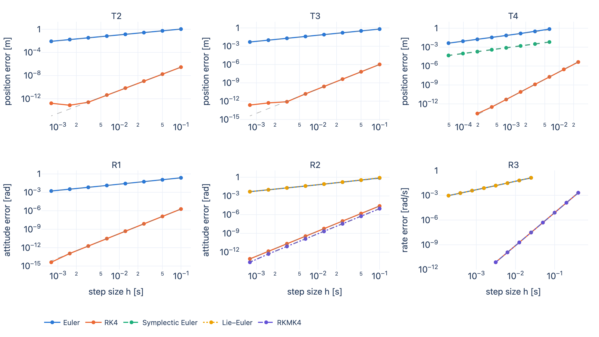
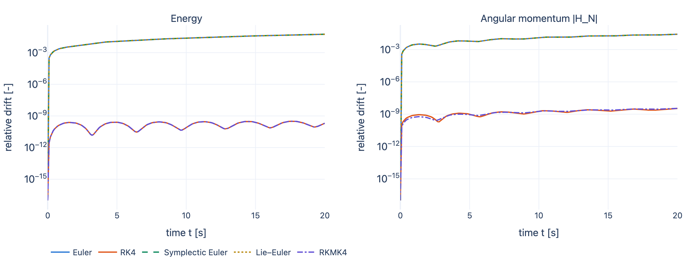
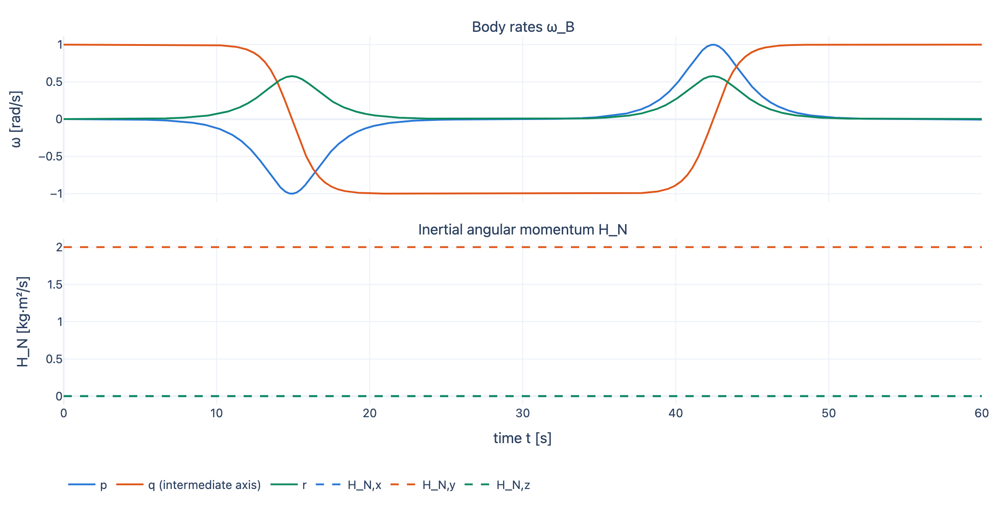

# flightsim

A C++20 six-degree-of-freedom rigid-body simulator built to be checked, not just run. Every integrator is validated against closed-form solutions (point mass with drag, harmonic oscillator, torque-free rotation with Jacobi elliptic functions, the intermediate-axis flip), with measured convergence orders and conservation laws asserted in CI. An F-16 model, trim, linearization, JSBSim cross-validation and an altitude/airspeed autopilot are planned (see the roadmap below).

> This file is generated from `docs/README.template.md` by `python -m flightsim_analysis.report`; its numbers come from `out/metrics.json`.

## Headline results

32 of 32 asserted convergence orders land inside their bounds: Euler, symplectic Euler and Lie–Euler measure 0.993–1.046 (bound [0.95, 1.05]); RK4 and RKMK4 measure 3.958–4.020 (bound [3.9, 4.1]).



On the torque-free asymmetric body R3 at h = 0.02 s over 20 s, the maximum relative energy drift is 5.5e-02 for Euler, 3.2e-10 for RK4 and 3.2e-10 for RKMK4. Without renormalization the quaternion norm drifts 6.5e-02 (Euler) and 2.5e-11 (RK4); RKMK4 needs no projection (1.1e-15).



Spin about the intermediate axis flips: the body rate q changes sign 2 times in 60 s while energy drifts 1.4e-14 and angular momentum 1.8e-14 (RK4, h = 0.001 s).



A rigid-body RK4 step with gravity and quadratic drag costs 99 ns on the benchmark machine (Euler 28 ns, RKMK4 213 ns). The step loop performs zero heap allocations (asserted by `alloc_tests`).

## Quickstart

Requires CMake ≥ 3.25, a C++20 compiler, Ninja and [uv](https://docs.astral.sh/uv/). Dependencies (Eigen, GoogleTest, Google Benchmark, toml++) are fetched at configure time with pinned hashes.

```sh
scripts/demo.sh        # configure + build (release), ctest, uv sync --frozen, run, report
open out/index.html    # prints its path when done
```

Individual pieces:

```sh
cmake --preset release && cmake --build --preset release -j && ctest --preset release
build/release/flightsim run scenarios/rb_dzhanibekov.toml --out out/rb_dz        # trajectory.csv + metadata.json
build/release/flightsim converge scenarios/studies/core_convergence.toml --out out/convergence
build/release/bench_flightsim
cd python && uv sync --frozen && uv run pytest
```

`out/index.html` is a single static page with Plotly's JavaScript inlined (no network needed); it works in light and dark mode.

## Documents

- [`docs/PRD.md`](docs/PRD.md): the specification and validation strategy.
- [`docs/design.md`](docs/design.md): architecture, conventions with the test that pins each, derivations, decision log, limitations.
- [`docs/results.md`](docs/results.md): every measured number (generated).

## Roadmap

Done: rigid-body core, translational and rotational validation, five integrators (Euler, RK4, symplectic Euler, Lie–Euler, RKMK4), analysis tooling and report. Coming in M4–M7: F-16 model and consistency laws, trim and linearization, JSBSim cross-validation, actuators and autopilot.

MIT licensed.
